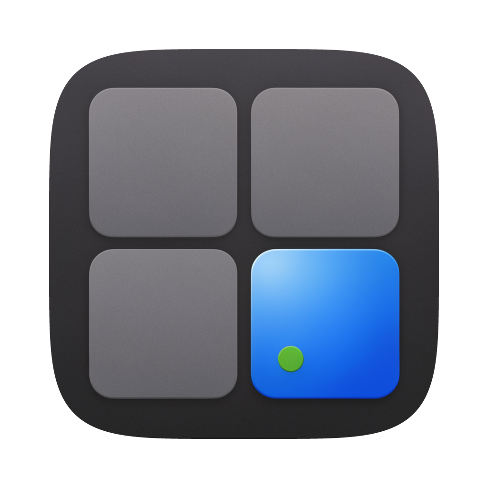
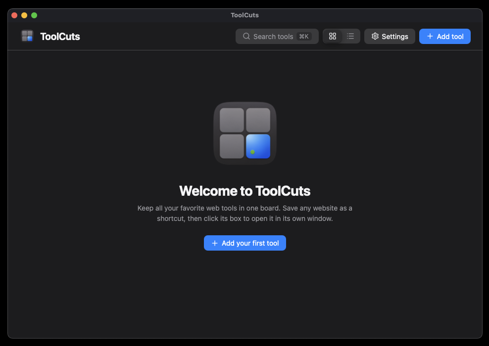
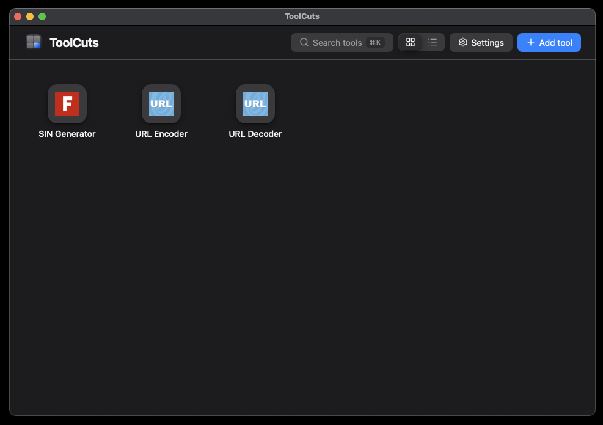
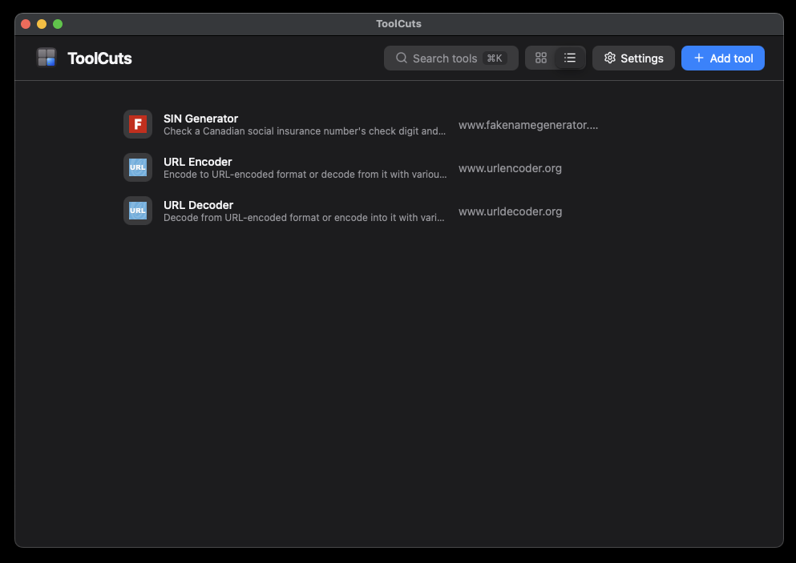
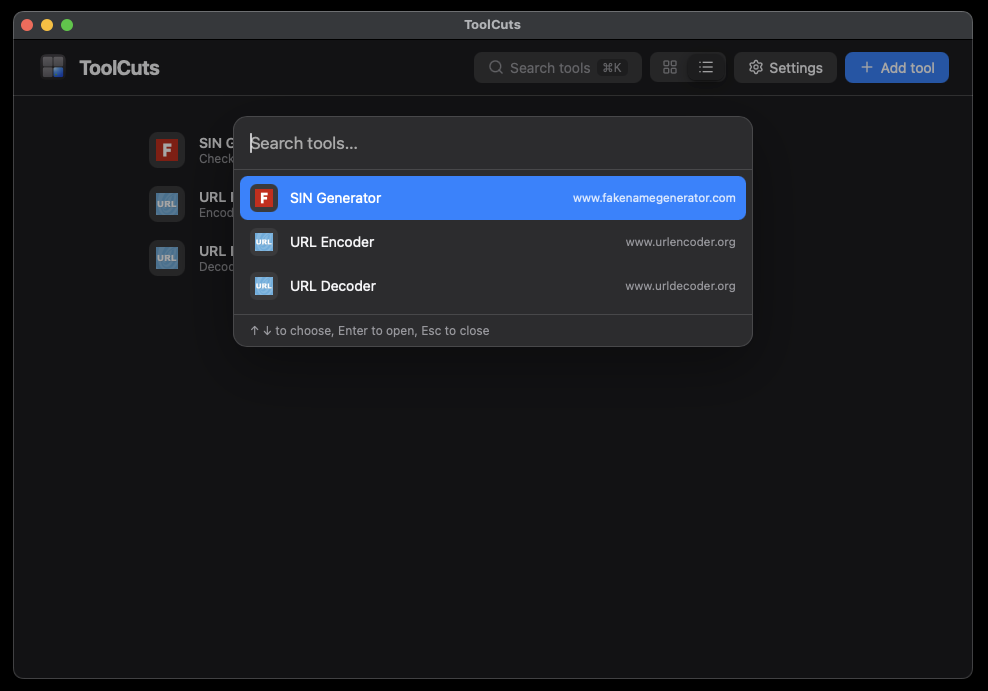

<p align="center">
  
</p>

<h1 align="center">ToolCuts</h1>

<p align="center">
  A tiny desktop launcher that keeps your favorite web tools in one board.
</p>

ToolCuts turns the websites you reach for every day (encoders, generators, dashboards, internal tools) into a board of shortcuts. Add a URL, click its box, and the tool opens in its own window. It is about 6 MB, has no server, and is built on [tinyjs](https://tinyjs.app): a [txiki.js](https://github.com/saghul/txiki.js) backend with a native webview window instead of Electron.



## Features

- **One board for all your tools.** Save any URL as a shortcut box.
- **Opens in its own window.** Each tool gets a separate window, so it works even for sites that refuse to load inside an iframe (`X-Frame-Options`). The board marks tools that are currently open.
- **Smart add.** Enter a URL and ToolCuts fetches the page title, description and favicon for you. Type just `example.com` and `https://` is added; type a full URL with `http://` or `https://` and it is kept as written.
- **Configure each tool.** Edit the name, URL, description and icon (emoji, image URL, or the site's favicon). Offline or missing favicons fall back to a default icon.
- **Grid or list view.** The list view shows each tool's description under its name.
- **Quick search.** Press `⌘K` to filter your tools and open one with Enter.
- **Keyboard friendly.** `⌘N` adds a tool, and every box can be reached with Tab and opened with Enter.
- **Copy a tool's URL** with one click, and drag boxes to reorder them.
- **Safe deletes.** Optionally ask for confirmation before removing a tool (Settings).
- **Looks native.** Follows the system light and dark appearance.

| Grid view | List view | Search (`⌘K`) |
| --- | --- | --- |
|  |  |  |

## Using ToolCuts

| Action | How |
| --- | --- |
| Add a tool | `+ Add tool` or `⌘N`, then enter the URL |
| Open a tool | Click its box (or focus it and press Enter) |
| Search tools | `⌘K` or the Search button; ↑ ↓ to choose, Enter to open |
| Edit a tool | Hover the box and click the gear icon |
| Copy a tool's URL | Hover the box and click the copy icon |
| Remove a tool | Hover the box and click the × icon |
| Reorder | Drag a box or row onto another |
| Switch view | Grid / list toggle in the header |

Your tools and settings are stored locally with the tinyjs store. Nothing is sent anywhere except the requests that fetch each page's title and description, and the favicon lookup (Google's favicon service).

## Run it

You need the [tinyjs CLI](https://tinyjs.app). ToolCuts requires tinyjs 0.42.2 or newer and macOS 15 or newer.

```sh
git clone https://github.com/RomAnoX/ToolCuts.git
cd ToolCuts
tinyjs dev      # run with hot reload
```

## Build

```sh
tinyjs build --dmg              # dist/ToolCuts.app and dist/ToolCuts-0.1.0.dmg
tinyjs build --dmg --universal  # one build for Intel and Apple Silicon
```

Builds are ad-hoc signed. To distribute the app to other people without a Gatekeeper warning, sign it with your own identity and run `tinyjs notarize`. Change the app `id` in `tinyjs.json` (`com.example.toolcuts` by default) before releasing.

## Project layout

```
tinyjs.json          app config (name, window size, id, api access rules)
icon.png             app icon (1024x1024)
src/main.js          backend: reports closed tool windows to the board
src/frontend/        the board UI
  index.html         markup and dialogs
  style.css          styles (light and dark)
  app.js             board logic: tools, search, settings, shortcuts
  icons.js           Lucide icons, bundled for offline use
  tool.html          small page that opens a tool's URL in its own window
```

### Security note

Tools open in a window that can load any website, so `tinyjs.json` restricts the tinyjs bridge (`api.origins`) to the app's own local pages. Websites you open cannot call into the backend. Keep that setting if you change the config.

## Credits

Icons by [Lucide](https://lucide.dev) (ISC license). Built with [tinyjs](https://tinyjs.app).

## License

[MIT](LICENSE)
